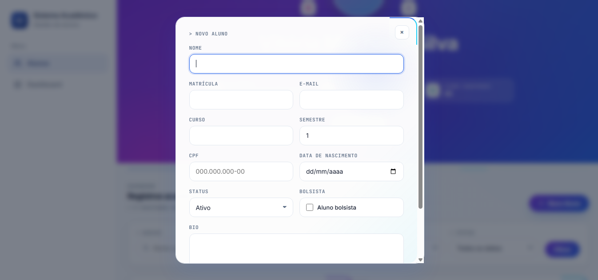
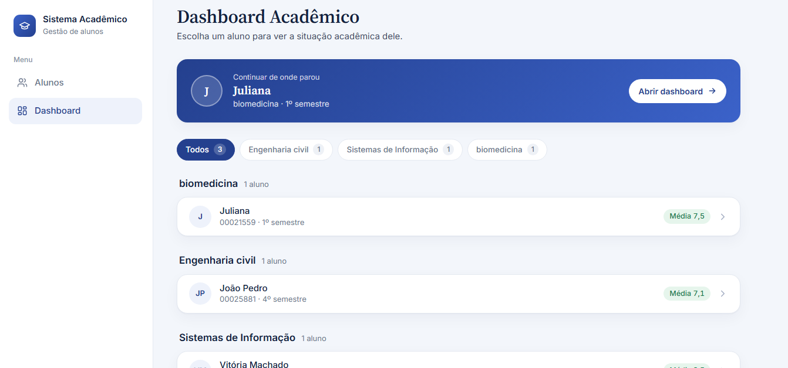
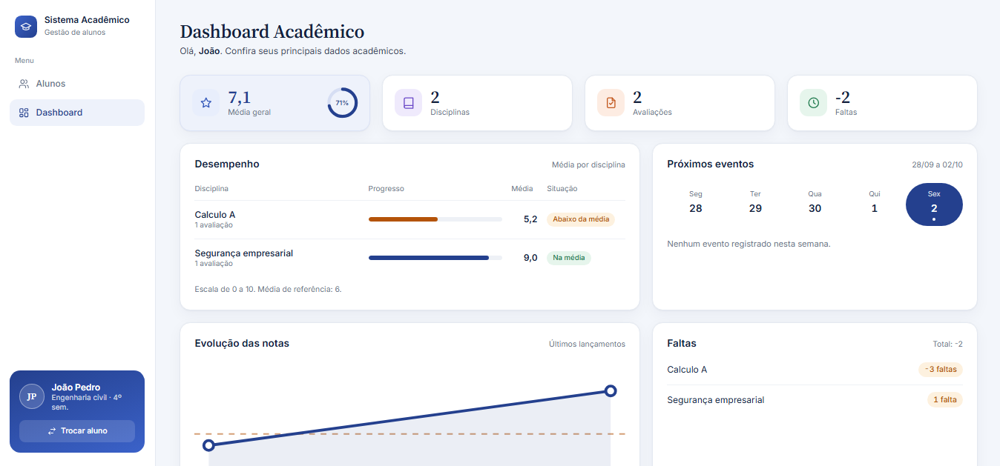
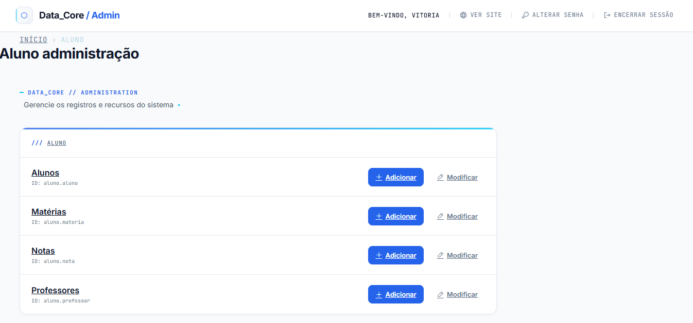
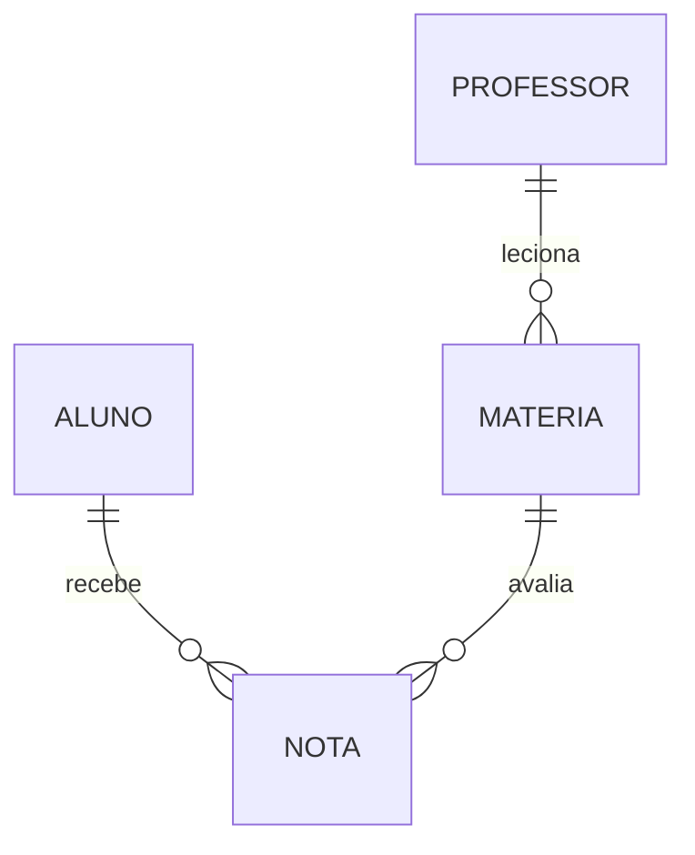

# 🎓 Projeto Aluno · Django | Cartão de Identidade Acadêmica

**Desafio da disciplina: Desenvolvimento Back-end**

---

## 👥 Integrante

- Vitória Machado Silva

---

## 📖 Descrição do Tema

A coordenação do curso decidiu modernizar a forma como os alunos se apresentam dentro do ambiente acadêmico. Em vez da tradicional carteirinha estática, foi criado o **Cartão de Identidade Acadêmica digital**: um perfil no estilo "ficha de personagem", onde cada aluno é representado por informações centrais que descrevem quem ele é, sua situação no curso, seus dados de contato e seus interesses.

O projeto é um sistema acadêmico simples em **Django 6.1** para cadastro, listagem, edição e exclusão de alunos, com painel administrativo customizado **Data_Core / Admin**. Ele foi desenvolvido em etapas:

1. **Antes do CRUD** — modelagem inicial do aluno, estrutura do projeto e customização do painel administrativo.
2. **CRUD completo** — telas de listagem, criação, edição e exclusão, com busca e filtros, e expansão do modelo de dados para um cartão de identidade acadêmica completo (campos de texto, numéricos, booleanos e de data).
3. **Etapa 1: Modelagem inicial + Dashboard** — modelagem relacional com 4 models (incluindo relações 1:N) e um **Dashboard Acadêmico** que exibe dados reais do banco para cada aluno.

---

## 📸 Demonstração








---

## 🛠 Tecnologias Utilizadas
- **Python 3.13**
- **Django 6.1**
- **SQLite** (incluso por padrão)
- **HTML + CSS** (templates do Django, sem frameworks de interface)
- **CSS** (Customização do Admin com `data-core-admin.css`)

---

## 🧱 Etapa 1: Modelagem inicial + Dashboard

Nesta etapa o projeto deixou de ter um único model e passou a representar uma pequena estrutura acadêmica de verdade: alunos, professores, matérias e notas, todos ligados por relacionamentos. Em cima dessa modelagem foi criado o primeiro **Dashboard Acadêmico**, que lê os dados reais do banco (nada de números fixos no código).

### 🗂️ Models (4 models, com relações 1:N)

| Model | Descrição |
| --- | --- |
| `Aluno` | Cartão de identidade do aluno (já existente desde as etapas anteriores). |
| `Professor` | Docente responsável por matérias. |
| `Materia` | Disciplina do curso, vinculada a um professor. |
| `Nota` | Lançamento de nota e faltas de um aluno em uma matéria. |

> No código existe também o alias `Disciplina = Materia`, mantido apenas por compatibilidade com nomes antigos.

#### Campos de `Professor`

| Campo | Tipo Django | Regra | Descrição |
| --- | --- | --- | --- |
| `nome` | `CharField` | Obrigatório | Nome do professor. |
| `email` | `EmailField` | Obrigatório | E-mail de contato. |
| `especialidade` | `CharField` | Obrigatório | Área de atuação. |
| `ativo` | `BooleanField` | Obrigatório | Professor ativo (padrão: Sim). |

#### Campos de `Materia`

| Campo | Tipo Django | Regra | Descrição |
| --- | --- | --- | --- |
| `nome` | `CharField` | Obrigatório | Nome da matéria. |
| `codigo` | `CharField` | Obrigatório, único | Código da matéria (ex: `BD101`). |
| `carga_horaria` | `IntegerField` | Obrigatório | Carga horária total. |
| `semestre` | `IntegerField` | Obrigatório | Semestre em que a matéria é ofertada (padrão: 1). |
| `professor` | `ForeignKey(Professor)` | Opcional | Professor responsável (`SET_NULL`). |
| `descricao` | `TextField` | Opcional | Resumo do conteúdo da matéria. |

#### Campos de `Nota`

| Campo | Tipo Django | Regra | Descrição |
| --- | --- | --- | --- |
| `aluno` | `ForeignKey(Aluno)` | Obrigatório | Aluno que recebeu a nota (`CASCADE`). |
| `materia` | `ForeignKey(Materia)` | Obrigatório | Matéria avaliada (`CASCADE`). |
| `nota` | `DecimalField` | Obrigatório | Nota lançada (ex: `8.70`). |
| `faltas` | `IntegerField` | Obrigatório | Faltas registradas (padrão: 0). |
| `data_lancamento` | `DateTimeField` | Automático | Data e hora do lançamento. |

### 🔗 Relacionamentos

| Relação | Tipo | Como foi implementada |
| --- | --- | --- |
| Professor → Matérias | **1:N** | `Materia.professor` (`related_name="materias"`) |
| Aluno → Notas | **1:N** | `Nota.aluno` (`related_name="notas"`) |
| Matéria → Notas | **1:N** | `Nota.materia` (`related_name="notas"`) |
| Aluno ↔ Matéria | N:N | Resolvida pela tabela `Nota`, que liga os dois lados |



### 📊 Dashboard Acadêmico

O dashboard é voltado para o **aluno** e mostra, de forma rápida, a situação acadêmica dele. Todos os valores vêm do banco por meio de consultas do ORM (`Avg`, `Sum` e `Count`).

| Bloco | O que mostra | De onde vêm os dados |
| --- | --- | --- |
| **Cards de resumo** | Média geral, quantidade de disciplinas, de avaliações e total de faltas | `Nota` (agregações do aluno) |
| **Desempenho** | Média por disciplina, com barra de progresso e situação | `Nota` agrupada por `Materia` |
| **Evolução das notas** | Gráfico com as últimas notas lançadas, em ordem de data | `Nota.data_lancamento` |
| **Faltas** | Faltas por disciplina (e não só um total solto) | `Nota.faltas` somado por matéria |
| **Próximos eventos** | Mini calendário semanal com o dia atual em destaque | Ainda sem fonte de dados (veja abaixo) |
| **Acesso rápido** | Atalhos para Microsoft 365 e portais acadêmicos | Links configurados no código |

**Regras de exibição adotadas**
- A escala das notas é de **0 a 10**, e a **média de referência é 6** (abaixo disso, a disciplina aparece em destaque como "Abaixo da média"). Os valores ficam nas constantes `NOTA_MAXIMA` e `NOTA_MINIMA` em `views.py`.
- Se o aluno tem mais de uma nota na mesma matéria, a disciplina mostra a **média** delas e cada nota conta como uma avaliação.
- As **faltas** de uma disciplina são a soma do campo `faltas` de todas as suas notas.
- Aluno sem notas continua funcionando: os cards mostram zero ou "—" e cada bloco explica o que vai aparecer quando houver dados.

**Próximos eventos (preparado para o futuro)**
Os models atuais não têm datas de provas ou trabalhos, então o calendário **não inventa dados**. Ele já está estruturado para receber eventos: basta implementar a função `_buscar_eventos()` em `views.py`, que hoje devolve uma lista vazia. O formato esperado de cada evento (data, título, horário e tipo) está documentado na própria função.

### 🧭 Navegação: sidebar e escolha do aluno

- Uma **sidebar compartilhada** (`_sidebar.html`) aparece na lista de alunos, na tela de escolha e no dashboard, com os links **Alunos** e **Dashboard**.
- Na lista de alunos, o modal de detalhes ganhou o botão **Dashboard**, que abre direto o painel daquele aluno.
- Ao clicar em **Dashboard** na sidebar, o usuário vai para uma **tela de escolha do aluno**: um índice agrupado por curso, com filtro por curso (links) e a **média geral** de cada aluno, sem repetir os cards da listagem. O último aluno aberto aparece em destaque como "Continuar de onde parou".
- Dentro do dashboard, a sidebar mostra o aluno atual e o atalho **Trocar aluno**.

### 📝 Como cadastrar os dados para o dashboard

Tudo é feito pelo painel administrativo (`/admin/`):

1. Cadastre os **professores** (opcional, mas útil para ligar às matérias).
2. Cadastre as **matérias** (nome, código, carga horária, semestre).
3. Garanta que o **aluno** exista (pela tela `/aluno/` ou pelo admin).
4. Em **Notas**, escolha o aluno, a matéria, a nota e as faltas. Repita para cada matéria do aluno.
5. Abra `/aluno/<id>/dashboard/` (ou use o botão **Dashboard** na lista de alunos).

---

## 🆕 Atualizações do Cartão de Identidade Acadêmica (etapa do CRUD)

A tela de registros acadêmicos e o modelo `Aluno` foram expandidos além da versão inicial (pré-CRUD). As principais adições:

### 🔍 Filtros e busca

A tela de listagem (`/aluno/`) ganhou uma barra de filtros acima da grade de alunos, permitindo refinar os registros por múltiplos critérios ao mesmo tempo:

- **Busca por nome ou matrícula** — campo de texto livre que localiza o aluno tanto pelo nome quanto pelo número de matrícula (`icontains` em `nome` e `matricula`).
- **Filtro por curso** — select preenchido dinamicamente com os cursos já cadastrados no banco.
- **Filtro por status** — select com as opções **Ativo**, **Trancado** e **Formado**.

Os filtros funcionam via `GET` (`?q=`, `?curso=`, `?status=`), então podem ser combinados entre si, compartilhados por link e continuam funcionando mesmo sem JavaScript. Quando nenhum resultado é encontrado, a tela diferencia "nenhum aluno cadastrado" de "nenhum resultado para esse filtro", já com um atalho para limpar os filtros.

### 🧾 Novos campos do Cartão de Identidade Acadêmica

O formulário de criação/edição de aluno ("Novo Aluno") foi ampliado para funcionar como um cartão de identidade completo, sem nenhum valor pré-preenchido — cada campo é digitado manualmente no cadastro. Os campos passaram a cobrir os principais tipos de dado:

| Campo | Tipo Django | Tipo de dado | Descrição |
| --- | --- | --- | --- |
| `nome` | `CharField` | Texto | Nome completo do aluno. |
| `matricula` | `CharField` | Texto | Número de matrícula (usado também na busca). |
| `email` | `EmailField` | Texto | E-mail de contato do aluno. |
| `cpf` | `CharField` | Texto | CPF do aluno. |
| `curso` | `CharField` | Texto | Curso atual (ex: ADS, SI, Engenharia...). |
| `bio` | `TextField` | Texto | Breve descrição, interesses ou objetivos. |
| `status` | `CharField` (choices) | Texto | Situação do aluno: **Ativo**, **Trancado** ou **Formado**. |
| `semestre` | `IntegerField` | Numérico | Semestre atual do aluno. |
| `bolsista` | `BooleanField` | Booleano | Indica se o aluno é bolsista (Sim/Não). |
| `data_nascimento` | `DateField` | Data | Data de nascimento do aluno. |
| `criado_em` | `DateTimeField` | Data/Hora | Preenchido automaticamente no momento do cadastro. |

Ou seja, o modelo passou a contemplar, além dos campos de texto originais, um campo **numérico** (`semestre`), um campo **booleano** (`bolsista`) e campos de **data/data-hora** (`data_nascimento` e `criado_em`), cobrindo os principais tipos de dado usados em um cadastro acadêmico completo.

### 🖼️ Outras melhorias

- **Favicon** do projeto adicionado via arquivo estático (`img/favicon.png`), referenciado nos templates com `` / ``.
- Proteção contra tradução automática do navegador (`translate="no"` + `meta name="google" content="notranslate"`) para preservar os textos originais da interface (ex: "Buscar", "Matrícula", "ID").

---

## 🗃️ Campos do Model `Aluno`

| Campo | Tipo Django | Regra | Descrição |
| --- | --- | --- | --- |
| `nome` | `CharField` | Obrigatório | Nome completo do aluno. |
| `matricula` | `CharField` | Opcional | Número de matrícula. |
| `email` | `EmailField` | Opcional | E-mail de contato. |
| `cpf` | `CharField` | Opcional | CPF do aluno. |
| `curso` | `CharField` | Obrigatório | Curso atual (ex: ADS, SI, Engenharia...). |
| `semestre` | `IntegerField` | Obrigatório | Semestre atual (padrão: 1). |
| `status` | `CharField` (choices) | Obrigatório | Ativo, Trancado ou Formado (padrão: Ativo). |
| `bolsista` | `BooleanField` | Obrigatório | Aluno bolsista (padrão: Não). |
| `data_nascimento` | `DateField` | Opcional | Data de nascimento. |
| `bio` | `TextField` | Opcional | Breve descrição, interesses ou objetivos (limite sugerido: 280 caracteres). |
| `criado_em` | `DateTimeField` | Automático | Data e hora do cadastro. |

---

## 🚀 Instruções de Execução

### Pré-requisitos
- Python 3.13 instalado na máquina.

### Passo a passo

1. **Clonar o repositório e acessar a pasta do projeto**
   ```powershell
   git clone <url-do-repositorio>
   cd cartao-identidade-academica
   ```

2. **Criar ambiente virtual**
   ```powershell
   python -m venv venv
   venv\Scripts\Activate.ps1
   ```

3. **Instalar dependências**
   ```powershell
   pip install django
   ```

4. **Criar projeto Django** *(pule este passo se o projeto já vier pronto no repositório)*
   ```powershell
   django-admin startproject core .
   ```

5. **Criar app aluno** *(pule este passo se o projeto já vier pronto no repositório)*
   ```powershell
   python manage.py startapp aluno
   ```

6. **Registrar app em settings.py**
   ```python
   INSTALLED_APPS = [
       'django.contrib.admin',
       'django.contrib.auth',
       'django.contrib.contenttypes',
       'django.contrib.sessions',
       'django.contrib.messages',
       'django.contrib.staticfiles',
       'aluno',
   ]
   ```

   Certifique-se também de que `STATICFILES_DIRS` inclui as pastas usadas pelo projeto (`static/` para o CSS do admin e `img/` para o favicon e demais imagens):
   ```python
   STATIC_URL = 'static/'

   STATICFILES_DIRS = [
       BASE_DIR / 'static',
       BASE_DIR / 'img',
   ]
   ```

   O dashboard usa **sessão** para lembrar o último aluno aberto, então mantenha `django.contrib.sessions` em `INSTALLED_APPS` e o `SessionMiddleware` em `MIDDLEWARE` (ambos já vêm no padrão do Django).

   *(Opcional)* Para apontar os atalhos dos portais acadêmicos para os endereços reais, adicione ao `settings.py`:
   ```python
   FEPI_PORTAL_ALUNO_URL = 'https://...'
   FEPI_ENSINO_DIGITAL_URL = 'https://...'
   ```

7. **Configurar rotas**
   ```python
   # core/urls.py
   from django.contrib import admin
   from django.urls import path, include

   urlpatterns = [
       path('admin/', admin.site.urls),
       path('aluno/', include("aluno.urls")),
   ]
   ```

   ```python
   # aluno/urls.py
   from django.urls import path
   from . import views

   urlpatterns = [
       path('', views.aluno, name='listar_alunos'),
       path('novo/', views.criar_aluno, name='criar_aluno'),
       path('<int:pk>/editar/', views.editar_aluno, name='editar_aluno'),
       path('<int:pk>/excluir/', views.excluir_aluno, name='excluir_aluno'),

       # Dashboard acadêmico
       path('dashboard/', views.dashboard_aluno, name='dashboard_aluno'),
       path('<int:pk>/dashboard/', views.dashboard_aluno, name='dashboard_aluno_pk'),
   ]
   ```

8. **Aplicar as migrações do banco de dados**
   ```powershell
   python manage.py makemigrations
   python manage.py migrate
   ```

9. **Registrar admin**
   ```python
   from django.contrib import admin
   from .models import Aluno, Professor, Materia, Nota


   @admin.register(Aluno)
   class AlunoAdmin(admin.ModelAdmin):
       list_display = ("nome", "curso", "semestre", "status", "criado_em")
       search_fields = ("nome", "matricula", "curso")
       list_filter = ("curso", "status", "bolsista")


   @admin.register(Professor)
   class ProfessorAdmin(admin.ModelAdmin):
       list_display = ("nome", "especialidade", "email", "ativo")
       search_fields = ("nome", "especialidade")
       list_filter = ("ativo",)


   @admin.register(Materia)
   class MateriaAdmin(admin.ModelAdmin):
       list_display = ("codigo", "nome", "professor", "carga_horaria", "semestre")
       search_fields = ("nome", "codigo")
       list_filter = ("semestre", "professor")


   @admin.register(Nota)
   class NotaAdmin(admin.ModelAdmin):
       list_display = ("aluno", "materia", "nota", "faltas", "data_lancamento")
       search_fields = ("aluno__nome", "materia__nome")
       list_filter = ("materia", "aluno")
   ```

10. **(Opcional) Criar um superusuário para acessar o admin**
    ```powershell
    python manage.py createsuperuser
    ```

11. **Rodar o servidor**
    ```powershell
    python manage.py runserver
    ```

12. **Acessar no navegador**
    - Lista de alunos: `http://127.0.0.1:8000/aluno/`
    - Dashboard acadêmico: `http://127.0.0.1:8000/aluno/dashboard/`
    - Painel administrativo: `http://127.0.0.1:8000/admin/`

---

## 🌐 Endpoints

| Endpoint | Descrição |
| --- | --- |
| `/admin/` | Painel administrativo Django (customizado Data_Core) |
| `/aluno/` | Lista todos os alunos cadastrados |
| `/aluno/?q=&curso=&status=` | Lista filtrada por nome/matrícula, curso e/ou status |
| `/aluno/novo/` | Cadastra um novo aluno |
| `/aluno/<id>/editar/` | Edita um aluno existente |
| `/aluno/<id>/excluir/` | Confirma e exclui um aluno |
| `/aluno/dashboard/` | Tela de escolha do aluno para abrir o dashboard |
| `/aluno/dashboard/?escolher=1&curso=` | Tela de escolha filtrada por curso |
| `/aluno/<id>/dashboard/` | Dashboard acadêmico de um aluno específico |
| `/admin/aluno/aluno/add/` *(via admin)* | Adiciona novo aluno pelo painel administrativo |
| `/admin/aluno/aluno/<id>/change/` | Edita aluno existente pelo painel administrativo |
| `/admin/aluno/materia/` e `/admin/aluno/nota/` *(via admin)* | Cadastro de matérias e lançamento de notas |

---

## 📁 Estrutura do Projeto

```
cartao-identidade-academica/
│
├── aluno/
│   ├── migrations/
│   ├── templates/
│   │   ├── _sidebar.html
│   │   ├── aluno.html
│   │   ├── confirmar_exclusao.html
│   │   ├── dashboard_aluno.html
│   │   ├── dashboard_selecionar.html
│   │   └── form_aluno.html
│   ├── __init__.py
│   ├── admin.py
│   ├── apps.py
│   ├── models.py
│   ├── tests.py
│   ├── urls.py
│   └── views.py
│
├── core/
│   ├── __pycache__/
│   ├── __init__.py
│   ├── asgi.py
│   ├── settings.py
│   ├── urls.py
│   └── wsgi.py
│
├── img/
│   ├── favicon.png
│   ├── img_capa_alunos.png
│   ├── img_registros_alunos.png
│   ├── img_detalhes_alunos.png
│   ├── img_admin.png
│   ├── img_adicionar_aluno.png
│   ├── img_aluno_cadastrado.png
│   ├── dashboard-academico.png
│   ├── dashboard-aluno-individual.png
│   └── models.png
│
├── static/
│   └── admin/
│       └── css/
│           └── data-core-admin.css
│
├── templates/
│   └── admin/
│       ├── base_site.html
│       └── index.html
│
├── venv/
│
├── .gitattributes
├── db.sqlite3
├── LICENSE
├── manage.py
└── README.md
```