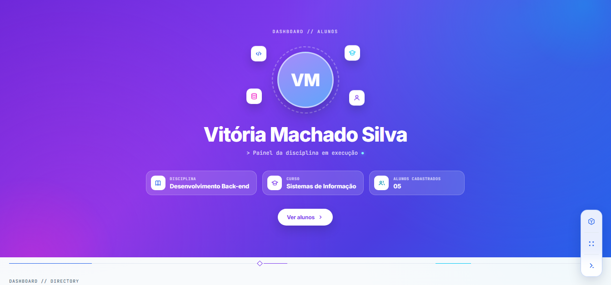
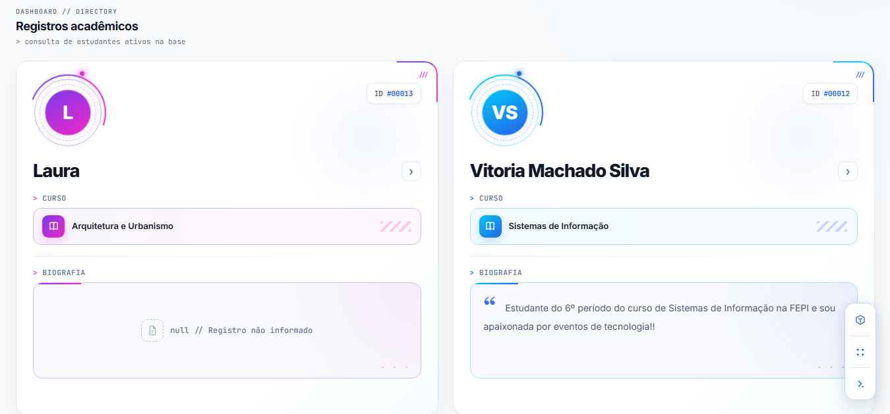
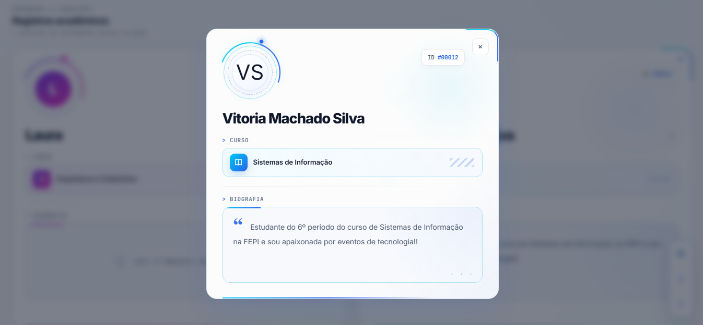
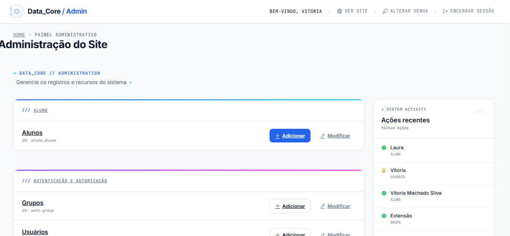
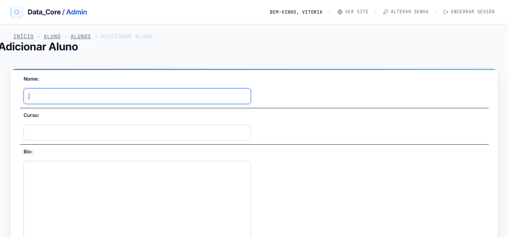
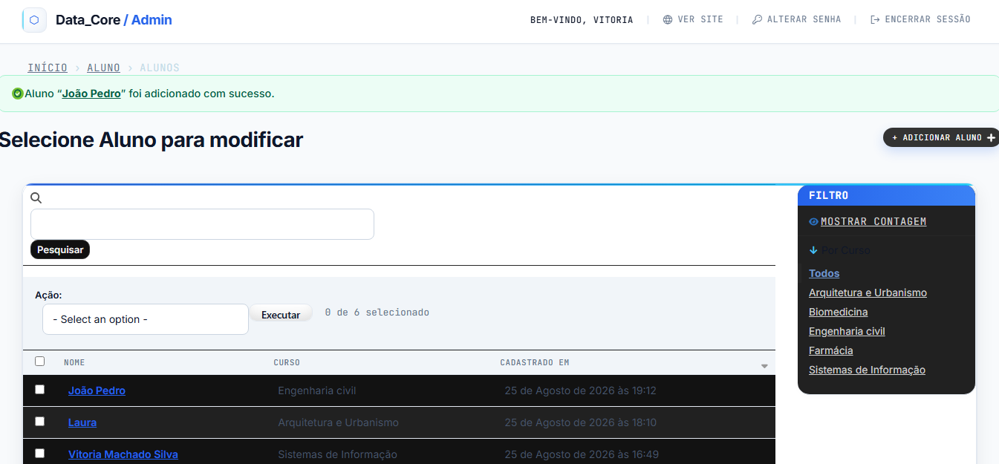

# cartao-identidade-academica
Desafio da disciplina desenvolvimento Back-end 

# 🎓 Projeto Aluno · Django | Cartão de Identidade Acadêmica

**Desafio da disciplina: Desenvolvimento Back-end**

Sistema acadêmico simples em **Django 6.1** para cadastro e listagem de alunos, com painel administrativo customizado **Data_Core / Admin**. 

A coordenação do curso decidiu modernizar a forma como os alunos se apresentam dentro do ambiente acadêmico. Em vez da tradicional carteirinha estática, foi criado o **Cartão de Identidade Acadêmica digital**: um perfil no estilo "ficha de personagem", onde cada aluno é representado por informações centrais que descrevem quem ele é, seus interesses e objetivos.

---

## 📸 Demonstração








---

## 🛠 Tecnologias Utilizadas
- **Python 3.13**
- **Django 6.1**
- **SQLite** (incluso por padrão)
- **CSS** (Customização do Admin com `data-core-admin.css`)

---

## 🗃️ Modelo de Dados Sugerido (`Aluno`)

O modelo de dados base para o Cartão de Identidade Acadêmica contém as seguintes informações obrigatórias:

| Campo | Tipo | Regra | Descrição |
| --- | --- | --- | --- |
| `nome` | `CharField` | Obrigatório | Nome completo do aluno. |
| `curso` | `CharField` | Obrigatório | Curso atual (ex: ADS, SI, Engenharia...). |
| `bio` | `TextField` | Obrigatório | Breve descrição, interesses ou objetivos (limite sugerido: 280 caracteres). |

---

## 🚀 Instalação e Configuração

### Pré-requisitos
- Python 3.13 instalado na máquina.

### Passo a passo

1. **Criar ambiente virtual**
```powershell
   python -m venv venv
   venv\Scripts\Activate.ps1


**Instalar dependências**
    pip install django

3. **Criar projeto Django**
    django-admin startproject core .

4. **Criar app aluno**
    python manage.py startapp aluno


5. **Registrar app em settings.py**
INSTALLED_APPS = [
    'django.contrib.admin',
    'django.contrib.auth',
    'django.contrib.contenttypes',
    'django.contrib.sessions',
    'django.contrib.messages',
    'django.contrib.staticfiles',
    'aluno',
]


6. **Configurar rotas**
from django.contrib import admin
from django.urls import path, include

urlpatterns = [
    path('admin/', admin.site.urls),
    path('aluno/', include("aluno.urls")),
]

aluno/urls.py
from django.urls import path
from . import views

urlpatterns = [
    path('', views.aluno, name='aluno'),
]


7. **Modelo aluno**
django-admin startproject core .


8. **Registrar admin**
from django.contrib import admin
from .models import Aluno

admin.site.register(Aluno)

9. **Rodar no servidor**
python manage.py runserver


| Endpoint | Descrição |
| --- | --- |
| ``/admin/`` | Painel administrativo Django (customizado Data_Core) |
| ``/aluno/`` | Lista todos os alunos cadastrados |
| ``/aluno/add`` *(via admin)* | Adiciona novo aluno |
| ``/aluno/<id>/change`` | Edita aluno existente |

cartao-identidade-academica/
│
├── aluno/
│   ├── models.py
│   ├── tests.py
│   ├── urls.py
│   └── views.py
│
├── core/
│   ├── __pycache__/
│   ├── __init__.py
│   ├── asgi.py
│   ├── settings.py
│   ├── urls.py
│   └── wsgi.py
│
├── static/
│   └── admin/
│       └── css/
│           └── data-core-admin.css
│
├── templates/
│   └── admin/
│       ├── base_site.html
│       └── index.html
│
├── venv/
│
├── .gitattributes
├── db.sqlite3
├── LICENSE
├── manage.py
└── README.md
